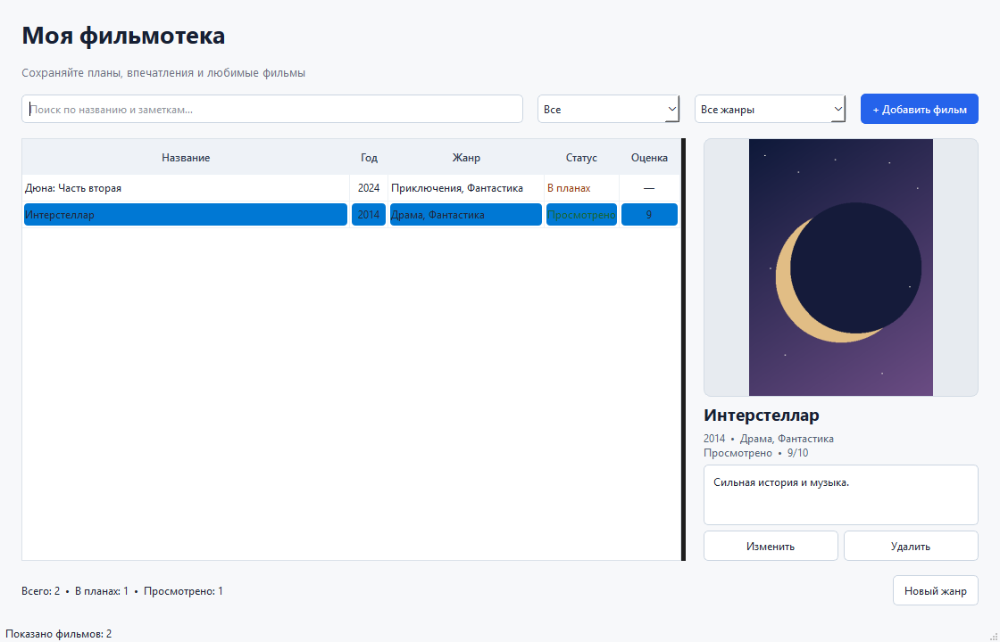

# Моя фильмотека

Настольный каталог фильмов на **PyQt6** и **SQLite**. Помогает вести список планов просмотра, сохранять оценки и заметки, прикреплять постеры и искать фильмы по жанрам.



## Возможности

- Статусы «В планах» и «Просмотрено», оценка просмотренных фильмов от 1 до 10.
- Несколько жанров у одного фильма и собственные жанры.
- Поиск по названию и заметкам, фильтрация по статусу и жанру.
- Постеры, которые приложение копирует в свою папку данных.
- Добавление, редактирование и удаление записей; работа мышью и горячими клавишами.

## Запуск

Требуются Windows 10/11 и Python 3.10 или новее.

```powershell
python -m venv .venv
.\.venv\Scripts\python.exe -m pip install -r requirements.txt
.\.venv\Scripts\python.exe -m movie_catalog.run
```

Готовая версия без установки Python: [MovieCatalog.exe](dist/MovieCatalog.exe). База данных создаётся при первом запуске в папке данных пользователя.

## Сборка `.exe`

```powershell
.\movie_catalog\build.ps1 -Python .\.venv\Scripts\python.exe
```

Результат появится в `dist\MovieCatalog.exe`. Обе формы `.ui` включаются в сборку. Инструкция по работе и хранению данных находится в [подробном README](movie_catalog/README.md).

## Структура

- `movie_catalog/main_window.ui`, `movie_catalog/movie_dialog.ui` — формы Qt Designer.
- `movie_catalog/main_window.py`, `movie_catalog/movie_dialog.py` — интерфейс и действия пользователя.
- `movie_catalog/database.py` — база SQLite с таблицами фильмов, жанров и связей между ними.
- `assets/screenshot.png` — снимок главного окна.

## Управление

`Ctrl+N` — добавить фильм, `Ctrl+F` — поиск, `Enter` — изменить выбранный фильм, `Delete` — удалить, `F5` — обновить список. Двойной щелчок открывает редактирование, правый щелчок — контекстное меню.
